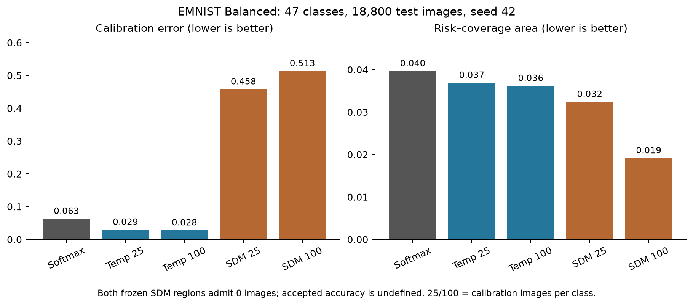
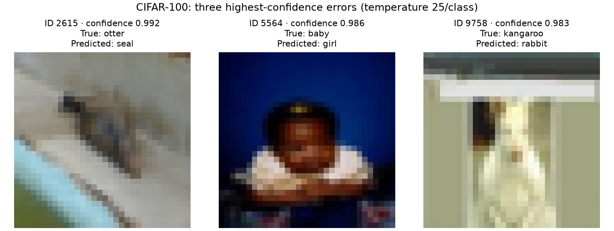
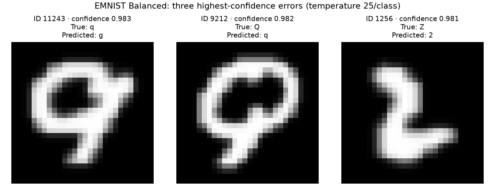

# SDM vision reliability research write-up draft

**Preliminary clean-data analysis — updated October 29, 2026.** This draft now
covers six completed classifiers. The original October 20 tables retain their
[dated evidence snapshot](assets/clean-results-2026-10-20.json); EMNIST Balanced
is added from a [separate October 29 verification](assets/clean-results-2026-10-29.json)
of previously completed, saved artifacts. No training, model inference or SDM
refitting was performed for this update. CIFAR-10, in-distribution SVHN and full
corruption/OOD evaluation remain unfinished, and the experiment campaign stays
paused. The [analysis plan](experiment-design.md) governs the final comparison.

## Abstract

We investigate whether similarity-distance-magnitude (SDM) confidence can support
useful selective prediction in multi-class vision. We compare a from-scratch
ResNet-18-style CIFAR-100 model with a pretrained ConvNeXt-Tiny family, evaluating
methods within each fixed checkpoint and label space. Calibration data fits
positive-temperature baselines and SDM estimators; evaluation reports probability
quality, error ranking, coverage and accuracy among admitted predictions.
Preliminary clean results show that temperature scaling reduces negative
log-likelihood and expected calibration error without changing top-1 predictions.
For CIFAR-100 ConvNeXt, larger SDM calibration support improves risk ranking but
neither calibration budget yields a qualifying 95% reliability region. The same
identity-adaptor implementation admits high-accuracy subsets on MNIST and KMNIST,
while Fashion-MNIST and EMNIST Balanced yield no qualifying region. These observations motivate
separate analysis of ranking, calibration and admission feasibility. They do not
yet establish behavior under corruption or far-OOD inputs.

## 1. Introduction

A classifier's ability to predict a label and its ability to identify trustworthy
predictions are different evaluation questions. A model can be accurate overall
while producing a subset of confident errors. Selective prediction makes that
tradeoff explicit: the model may answer some inputs and abstain on others. Its
utility depends on both accuracy among accepted predictions and the fraction of
inputs it accepts. A method that accepts nothing supplies no useful classification
coverage, even if it avoids confident errors.

Our research question is whether SDM confidence improves this reliability/coverage
tradeoff relative to raw softmax confidence and temperature scaling on the same
vision model. SDM incorporates representation-based similarity and distance
signals in addition to decision scores. We test two implementations separately:
a learned adaptor applied to ResNet representations and the identity-adaptor
formulation in the ConvNeXt notebooks. They are not interchangeable estimator
variants or a controlled adaptor ablation.

The evaluation extends from clean classification to a planned fixed set of
corruptions and a separate far-OOD dataset. We use 95% accuracy on admitted
predictions as an empirical target. We do not assume that meeting that target on
calibration data guarantees it on a changed input distribution. Published-method
background and the project's reading references are maintained in the
[SDM reference](allen-schmaltz-sdm.md) and [upstream implementation notes](upstream-sdm.md);
a complete related-work synthesis remains outside these preliminary results.

## 2. Methods

### 2.1 Classifiers and data separation

We retain the existing source-notebook recipes. The ResNet-18-style model trains
from scratch on 32-pixel CIFAR-100 inputs for 30 epochs with backbone seed 42 and
batch size 128. It uses SGD with momentum 0.9, Nesterov updates, weight decay
0.0005 and a one-cycle schedule with maximum learning rate 0.1. The final epoch
is the evaluation checkpoint; validation does not select it. Its 512-dimensional
representations support the learned SDM fits.

ConvNeXt-Tiny starts from torchvision's fixed `IMAGENET1K_V1` weights. Its full
runs use seed 42, 20 epochs, batch size 128, AdamW at learning rate 0.0003,
weight decay 0.05, cosine scheduling and cross-entropy label smoothing 0.1.
Validation top-1 selects the checkpoint. CIFAR training uses stochastic crops,
horizontal flips, RandAugment and random erasing; evaluation resizes to 256 and
center-crops to 224 with ImageNet normalization. Additional datasets use their
own documented transforms, including RGB replication for grayscale images and
no digit/handwriting flips. These preprocessing and training differences prevent
attributing cross-backbone differences solely to uncertainty estimation.

| Experiment | Training/reference | Validation | Standard calibration | Enlarged calibration | Current clean evaluation |
| --- | ---: | ---: | ---: | ---: | --- |
| ResNet CIFAR-100 | 45,000 | 2,500 | 2,500 | Not run | 2,500 validation images |
| ConvNeXt CIFAR-100 | 37,500 | 2,500 | 2,500 | 10,000 | 10,000 official test images |
| MNIST / Fashion-MNIST / KMNIST, each | 58,750 | 250 | 250 | 1,000 | 10,000 official test images |
| EMNIST Balanced (47 classes) | 106,925 | 1,175 | 1,175 | 4,700 | 18,800 official test images |

Within each class, seed-42 permutations allocate disjoint validation and
calibration sets. The ConvNeXt standard calibration set is nested within its
enlarged set. Additional dataset notebooks reserve 25 validation and 100 enlarged
calibration examples per class, retaining all remaining training support. The
table separates the ten-class tasks from the 47-class EMNIST task. The two
backbones have different training support and clean evaluation populations, so
all method comparisons below remain within their own experiment blocks.

### 2.2 Confidence methods and admission rules

Raw softmax uses the maximum predicted class probability as confidence. Positive
temperature scaling divides logits by a scalar fitted using calibration NLL.
Temperature fitting does not use evaluation labels and preserves each image's
predicted fine class. ConvNeXt fits a separate temperature for each calibration
budget, using the same frozen backbone.

ConvNeXt uses the notebook-04 frozen identity-adaptor SDM implementation and
constructs its high-reliability region from each calibration set at alpha .95.
ResNet uses saved `reexpress-sdm` learned-adaptor artifacts, fitted with SDM seed 0
and 20 epochs for fine-100 and coarse-20 label spaces. The adaptor may change
predictions. The coarse task is analyzed separately; it is not evidence of an
improvement on the original 100-class problem. The completed learned-adaptor fits
are not yet included in the aggregate ResNet comparison below because the
matched evaluation has not finished.

The ResNet baseline results include its plain calibration-frozen temperature
threshold. Global softmax/temperature admission comparisons for ConvNeXt will be
supplied by the matched evaluator for the original four tasks; their missing cells are not zero coverage. Section 3.4 adds a saved-output-only EMNIST comparison using the same global threshold convention.
That evaluator chooses attainable whole-confidence-group thresholds on calibration
only, with minimum calibration admissions of 1 for ResNet and 100 for ConvNeXt.
It reuses saved learned SDM policies for ResNet and the identity-adaptor region
for ConvNeXt. Its centroid/lower ResNet policies share central SDM probabilities;
they are separate admission policies, not independent models.

### 2.3 Metrics and uncertainty

We report full-coverage top-1 accuracy, NLL, multiclass Brier score, and expected
calibration error (ECE) using 15 bins. Smaller values of NLL, Brier and ECE are
better under their respective definitions; improvement in one need not imply
improvement in every other metric. Error AUROC/AUPRC treats prediction error as
the positive class. Risk-coverage calculations retain complete equal-confidence
groups, and AURC is the right-endpoint step integral including the first interval.
Lower AURC denotes less accumulated selective risk along that empirical ranking.
Retrospective curves do not fit the reported admission thresholds.

At each frozen admission rule, coverage is admitted count divided by evaluation
count; accepted accuracy is correct admitted count divided by admitted count.
Accepted accuracy is undefined with no admissions. We calculate 95% Wilson
intervals from saved per-image correctness and admission masks. These intervals
condition on the fitted rule and do not capture training-seed variability or
provide guarantees under shift. All results in this snapshot use one backbone
seed; no significance test for a method difference is claimed.

### 2.4 Remaining shift evaluation

The full matched protocol evaluates 15 standard CIFAR-100-C corruptions at five
severities and SVHN test images as far-OOD for each CIFAR model. Checkpoints,
representations, calibration identities and rules must be verified before those
results enter the write-up. CIFAR-100-C derives from official test images, so its
slices reuse base image identities and are not independent replicated trials.
SVHN far-OOD is evaluated using false-admission rates and ID-versus-OOD AUROC,
not CIFAR classification accuracy. ResNet validation and ConvNeXt official test
are their respective ID references. No shifted result or conclusion is supplied
in this draft.

## 3. Preliminary clean results

### 3.1 Temperature scaling improves ECE and NLL without changing accuracy

Table 1 separates ResNet validation from ConvNeXt official test. Accuracy and ECE
are percentages; NLL, Brier and AURC use their native scales. Calibration budgets
are examples per class. Raw softmax appears once per checkpoint even though the
collector repeats it in both paired ConvNeXt track groups.

**Table 1. CIFAR-100 clean probability and ranking metrics.**

| Population | Method | Calibration/class | Accuracy % | NLL | Brier | ECE % | AURC |
| --- | --- | ---: | ---: | ---: | ---: | ---: | ---: |
| ResNet validation | Raw softmax | — | 73.84 | 1.0005 | 0.3699 | 8.61 | 0.07708 |
| ResNet validation | Temperature | 25 | 73.84 | 0.9394 | 0.3586 | 2.15 | 0.07762 |
| ConvNeXt test | Raw softmax | — | 88.45 | 0.5197 | 0.1790 | 5.96 | 0.03618 |
| ConvNeXt test | Temperature | 25 | 88.45 | 0.4945 | 0.1816 | 3.36 | 0.03394 |
| ConvNeXt test | Temperature | 100 | 88.45 | 0.4945 | 0.1815 | 3.45 | 0.03401 |
| ConvNeXt test | SDM identity | 25 | 88.45 | 2.2341 | 0.5416 | 47.00 | 0.04768 |
| ConvNeXt test | SDM identity | 100 | 88.45 | 1.7137 | 0.4251 | 34.34 | 0.02629 |

On ResNet validation, temperature scaling reduces ECE from 8.61% to 2.15% and
NLL from 1.0005 to 0.9394 while accuracy remains 73.84%. Its plain frozen rule
accepts 1,314 of 2,500 images (52.56% coverage); 1,243 of those predictions are
correct, giving 94.60% accepted accuracy with a 95% Wilson interval of
[93.24%, 95.69%]. The point estimate falls below the 95% target; an interval
containing 95% is not evidence that the target is maintained.

For ConvNeXt, temperature scaling reduces test ECE from 5.96% to 3.36% with
25 calibration examples per class, and to 3.45% with 100 per class. NLL decreases
from 0.5197 to approximately 0.4945 in both cases. Brier score increases slightly,
from 0.1790 to 0.1816/0.1815. Thus, the probability-metric changes are mixed rather
than a uniform improvement in every measure. Top-1 accuracy stays at 88.45%.

### 3.2 Better SDM ranking does not establish a usable reliability region

For CIFAR-100, enlarging SDM calibration support changes error AUROC from 0.8233
to 0.8915 and AURC from 0.04768 to 0.02629. The latter is below the raw-softmax
AURC of 0.03618. However, neither calibration budget yields a finite qualifying
region at alpha .95, and both frozen SDM policies admit zero test examples.
Accepted accuracy is therefore undefined. The retrospective ranking improvement
cannot be substituted for useful coverage at the prescribed admission rule.

The enlarged SDM track does not improve every confidence measure: its NLL is
1.7137 versus raw softmax’s 0.5197, and ECE is 34.34% versus 5.96%. Error AUPRC
is 0.4322 versus 0.5071 for raw softmax, despite the higher error AUROC. Thus,
there is no uniform ordering of the methods across calibration and ranking metrics.

The saved calibration summaries show distance signal zero fractions of 37.44%
and 14.61% in the standard and enlarged CIFAR tracks. These diagnostics help
identify questions about feature geometry and region construction; they do not
establish the cause of region failure. No post-test lowering of alpha or
threshold adjustment is used to turn the no-region outcome into a success.

### 3.3 Dataset checks show selective admissions on some clean tasks

**Table 2. Completed extra-dataset classifier accuracy and standard-track
softmax-to-temperature comparison.** Both methods share the listed test accuracy;
NLL uses its native scale and ECE is a percentage.

| Dataset | Test accuracy % | NLL raw → temperature | ECE % raw → temperature |
| --- | ---: | ---: | ---: |
| mnist | 99.65 | 0.1030 → 0.0190 | 8.72 → 0.18 |
| fashion_mnist | 95.02 | 0.2244 → 0.1853 | 6.85 → 1.74 |
| kmnist | 98.45 | 0.1386 → 0.0740 | 8.17 → 0.52 |
| emnist_balanced (October 29 addition) | 90.38 | 0.4009 → 0.3731 | 6.29 → 2.94 |

These four completed extra datasets show lower temperature-scaled ECE and NLL, but
similar-looking classification accuracies do not imply the same SDM admission
behavior. Table 3 uses each dataset's saved identity-adaptor policy at alpha .95.
Its intervals are calculated from the saved per-image decisions, rather than
filled from missing aggregate interval columns.

**Table 3. Frozen SDM admissions on completed ConvNeXt clean tests.** Accuracy
and coverage are percentages. Each bracket is a 95% Wilson interval conditional
on the fitted rule; 100% observed accuracy is not certainty of future correctness.

| Dataset | Calibration/class | Region found on calibration | Admitted / total | Coverage % | Accepted accuracy % [95% interval] |
| --- | ---: | --- | ---: | ---: | --- |
| cifar100 | 25 | No | 0 / 10,000 | 0.00 | Undefined |
| cifar100 | 100 | No | 0 / 10,000 | 0.00 | Undefined |
| mnist | 25 | Yes | 6,069 / 10,000 | 60.69 | 100.00 [99.94, 100.00] |
| mnist | 100 | Yes | 4,981 / 10,000 | 49.81 | 100.00 [99.92, 100.00] |
| fashion_mnist | 25 | No | 0 / 10,000 | 0.00 | Undefined |
| fashion_mnist | 100 | No | 0 / 10,000 | 0.00 | Undefined |
| kmnist | 25 | Yes | 3,314 / 10,000 | 33.14 | 100.00 [99.88, 100.00] |
| kmnist | 100 | Yes | 3,992 / 10,000 | 39.92 | 99.95 [99.82, 99.99] |
| emnist_balanced | 25 | No | 0 / 18,800 | 0.00 | Undefined |
| emnist_balanced | 100 | No | 0 / 18,800 | 0.00 | Undefined |

MNIST admits 60.69% of test images in the standard track and 49.81% in the
enlarged track, with no observed admitted errors in either. More calibration data
does not monotonically increase coverage. KMNIST admits 33.14% and 39.92%, with
zero and two admitted errors respectively. Fashion-MNIST has no qualifying region
in either track despite 95.02% full-coverage accuracy. These observations do not
support a universal claim that SDM forms a useful 95% region for vision tasks.
They also do not establish an advantage over global softmax/temperature admission
rules by themselves. Section 3.5 supplies the saved-output global-policy
comparison for all five completed ConvNeXt tasks; ResNet learned-SDM and
shifted-population comparisons remain unfinished.

### 3.4 EMNIST: improved ranking remains separate from useful admission

The October 29 addition verifies a completed 47-class EMNIST Balanced run on
18,800 official test images: 16,992 correct, or 90.38% full-coverage accuracy.
Its training, validation and enlarged-calibration indices are disjoint; the
standard calibration set is nested within the enlarged set. Each test class has
400 images. These checks establish artifact consistency, not a new independent
training replication.

**Table 4. EMNIST clean probability and ranking metrics.** ECE is a percentage;
NLL and AURC use their native scales. All methods retain the same class predictions.

| Method | Calibration/class | NLL | ECE % | Error AUROC | AURC |
| --- | ---: | ---: | ---: | ---: | ---: |
| Raw softmax | — | 0.4009 | 6.29 | 0.8352 | 0.03964 |
| Temperature | 25 | 0.3731 | 2.94 | 0.8442 | 0.03686 |
| Temperature | 100 | 0.3726 | 2.76 | 0.8465 | 0.03615 |
| SDM identity | 25 | 1.7937 | 45.77 | 0.8310 | 0.03239 |
| SDM identity | 100 | 1.8077 | 51.30 | 0.8811 | 0.01912 |

SDM's enlarged track improves error AUROC and AURC relative to raw softmax,
while its exported NLL and ECE are worse. Neither SDM track finds a qualifying
alpha-.95 region, and both admit zero test images. Accepted accuracy is undefined.
Thus, a better retrospective ranking does not establish a useful frozen rule.
The SDM NLL/ECE values above are reconciled native exports; the verification
recomputes their ranking metrics and admission counts from saved per-image scores,
but does not reconstruct the full SDM probability matrices.



**Figure 1.** EMNIST's calibration and ranking measures disagree about method
ordering. Source: the October 29 snapshot, Table 4. ECE uses rate units in the
figure (0.063 corresponds to 6.3%). AURC is the step integral over whole-score
groups; neither panel measures coverage under the frozen SDM admission rule.

Saved calibration logits also permit a matched-checkpoint global-baseline
analysis without running the classifier. For each calibration budget we choose
the lowest attainable whole-group confidence threshold attaining empirical
95% calibration accuracy with at least 100 calibration admissions, using raw
softmax or the already fitted temperature. Only calibration inputs choose the
threshold. Applying each rule to saved test scores yields Table 5. This analysis
was constructed after historical test exploration and is not a blind prospective
validation. Its global empirical criterion differs from SDM's class-conditional
region construction.

**Table 5. EMNIST calibration-selected global admissions.** All percentages are
computed from saved per-image decisions; brackets are 95% Wilson intervals
conditional on each fitted rule.

| Method | Calibration/class | Test admitted / 18,800 | Test coverage % | Accepted accuracy % [95% interval] |
| --- | ---: | ---: | ---: | --- |
| Raw softmax | 25 | 15,934 | 84.76 | 96.13 [95.82, 96.42] |
| Temperature | 25 | 15,911 | 84.63 | 96.17 [95.86, 96.46] |
| Raw softmax | 100 | 16,866 | 89.71 | 94.56 [94.21, 94.90] |
| Temperature | 100 | 16,884 | 89.81 | 94.56 [94.21, 94.89] |

The 25/class rules have accepted-accuracy point estimates above 95%, whereas
both 100/class rules fall below it while admitting more images. More calibration
support does not guarantee higher held-out accepted accuracy under this empirical
selection rule. These results do not show a causal effect of calibration-set size
or establish a shift guarantee; they are a single-checkpoint, single-seed comparison.

### 3.5 Frozen global rules on all completed ConvNeXt tasks

A separate [saved-output analysis packet](assets/clean-analysis-2026-10-29/evidence.json)
extends the EMNIST comparison to all five completed ConvNeXt classifiers. Every
row uses its own checkpoint and official test population. Calibration selects the
largest whole-score-group coverage at empirical accuracy >=95%, with at least
100 calibration admissions. Temperatures are the saved fits, not retuned on test.
This is a retrospective analysis after historical test exploration; it does not
supply evidence about corruption, OOD or unrun training seeds.

**Table 6. Calibration-selected temperature rules across completed tasks.**
Coverage and accepted accuracy are percentages. Exact counts, Wilson intervals,
raw-softmax/SDM policies and confidently-wrong rates accompany all 30 policy rows
in the packet. Calibration support is per class.

| Dataset | Coverage, 25/class % | Accepted accuracy, 25/class % | Coverage, 100/class % | Accepted accuracy, 100/class % |
| --- | ---: | ---: | ---: | ---: |
| CIFAR-100 | 85.09 | 95.06 | 84.88 | 95.11 |
| MNIST | 99.81 | 99.70 | 99.97 | 99.66 |
| Fashion-MNIST | 99.60 | 95.24 | 98.05 | 96.03 |
| KMNIST | 99.48 | 98.73 | 99.85 | 98.57 |
| EMNIST Balanced | 84.63 | 96.17 | 89.81 | 94.56 |

These conditional accuracies must be read with coverage. The MNIST and KMNIST
classifiers already exceed the target at full coverage, whereas CIFAR-100 requires
substantial abstention. EMNIST's enlarged-calibration rules miss the held-out
accuracy target despite reaching it on calibration. The dataset rows are separate
experiments; their numerical differences do not isolate architecture or task
complexity effects. SDM uses a different class-conditional policy and has the
admissions in Table 3; a global threshold's usable coverage is not proof of a
statistical guarantee equivalent to SDM's intended criterion.

### 3.6 Directed confusions and reproducible error examples

The packet checks every test ID, target, predicted label and correctness flag
against the saved output arrays. Confusion matrices sum to the full test
population and their traces equal the recorded correct counts. Directed pairs
are selected by largest error count, breaking ties by class IDs. Each gallery
selects the three largest saved standard-track temperature confidences among
errors, breaking ties by test ID. These choices are descriptive after test
exploration; selected cases do not estimate an overall error frequency.

**Table 7. Most frequent directed confusion in each completed task.** Counts
have different class supports and cannot be compared as normalized error rates
across datasets. The packet includes all class supports and recalls.

| Dataset | True class | Predicted class | Error count |
| --- | --- | --- | ---: |
| CIFAR-100 | maple_tree | oak_tree | 16 |
| MNIST | 4 - four | 9 - nine | 4 |
| Fashion-MNIST | T-shirt/top | Shirt | 62 |
| KMNIST | na | o | 23 |
| EMNIST Balanced | F | f | 137 |

The confusions suggest classes to inspect, not a causal explanation for SDM
region failure or proof of incorrect labels. In particular, upper/lower-case
handwriting and tree categories can look similar at the displayed resolution,
but this analysis does not adjudicate annotation validity.

Full confusion matrices are provided as integer counts and row-normalized
heatmaps. Row labels are true classes and column labels are predictions; class
supports remain available so counts can be normalized appropriately.

| Dataset | Counts | Heatmap |
| --- | --- | --- |
| CIFAR-100 | [CSV](assets/clean-analysis-2026-10-29/cifar100-confusion.csv) | [PNG](assets/clean-analysis-2026-10-29/cifar100-confusion-matrix.png) |
| MNIST | [CSV](assets/clean-analysis-2026-10-29/mnist-confusion.csv) | [PNG](assets/clean-analysis-2026-10-29/mnist-confusion-matrix.png) |
| Fashion-MNIST | [CSV](assets/clean-analysis-2026-10-29/fashion_mnist-confusion.csv) | [PNG](assets/clean-analysis-2026-10-29/fashion_mnist-confusion-matrix.png) |
| KMNIST | [CSV](assets/clean-analysis-2026-10-29/kmnist-confusion.csv) | [PNG](assets/clean-analysis-2026-10-29/kmnist-confusion-matrix.png) |
| EMNIST Balanced | [CSV](assets/clean-analysis-2026-10-29/emnist_balanced-confusion.csv) | [PNG](assets/clean-analysis-2026-10-29/emnist_balanced-confusion-matrix.png) |



**Figure 2.** Three selected CIFAR-100 errors. Labels, confidence values and test
IDs come from the same saved checkpoint/population as Table 6. The public dataset
images are illustrative excerpts, not a new independent evaluation.



**Figure 3.** Three selected EMNIST errors, displayed upright using the experiment's
transpose. Selection follows the confidence/ID rule above.

The complete figure packet provides [CIFAR-100 confusions](assets/clean-analysis-2026-10-29/cifar100-confusions.png),
[MNIST confusions](assets/clean-analysis-2026-10-29/mnist-confusions.png) and
[examples](assets/clean-analysis-2026-10-29/mnist-errors.png),
[Fashion-MNIST confusions](assets/clean-analysis-2026-10-29/fashion_mnist-confusions.png)
and [examples](assets/clean-analysis-2026-10-29/fashion_mnist-errors.png),
[KMNIST confusions](assets/clean-analysis-2026-10-29/kmnist-confusions.png) and
[examples](assets/clean-analysis-2026-10-29/kmnist-errors.png), and
[EMNIST confusions](assets/clean-analysis-2026-10-29/emnist_balanced-confusions.png).

## 4. Failure analysis and limitations

Three distinct behaviors must remain separate: the model's label accuracy,
probability calibration, and the usefulness of its admission rule. CIFAR-100's
enlarged SDM track improves AURC while failing to form a qualifying region; MNIST's
larger calibration track reduces coverage despite perfect observed admitted
accuracy. These are findings to explain, not reasons to select a favorable metric
and suppress the rest.

Possible explanations include class-conditional support, tied confidence groups,
distance/similarity distributions and differences in region construction. No
controlled ablation in this snapshot identifies one of these as the mechanism.
The learned ResNet adaptor and ConvNeXt identity adaptor also differ in predictions
and fitting, so their behavior cannot isolate an architecture effect.

There is one backbone seed per dataset, and the five completed ConvNeXt tasks are
only a subset of the planned seven. The protocols use different architectures,
pretraining, training supports, transforms and checkpoint-selection rules.
ResNet validation is not the ConvNeXt final-test population. Historical project
test exploration and preparation of the analysis plan after viewing some results
also prevent presenting this work as a fully blind preregistered evaluation.
CIFAR/SVHN experiments do not establish deployed inspection or safety performance.

The October 29 source audit reproduced tied-confidence threshold defects in
legacy ResNet notebooks 04–10 and validation-dependent coverage matching in
07, 09 and 10. Their saved tables and narrative comparisons are not incorporated
as verified numerical evidence here. [PR #33](https://github.com/Catpockets/sdm-vision-reliability/pull/33)
repairs those paths and the class-sweep evaluator; source repairs alone do not
revalidate old numbers. The October 20 campaign snapshot uses the separately
recorded grouped-metric definition and is preserved unchanged. New Imagenette,
selected-class and class-sweep findings require matching checkpoint/split/SDM
artifacts and corrected offline evaluation before inclusion. Observing overlapping
intervals does not establish equivalence, and empirical classwise calibration
criteria do not become guarantees on arbitrary new distributions.

## 5. Questions for the SDM methodology discussion

Ask the method author to distinguish estimator assumptions from implementation
choices before adding new experiments:

1. In the identity-adaptor implementation, which calibration diagnostics best
   explain no finite alpha-.95 region despite improved error ranking? Supply the
   observed CIFAR distance-zero fractions and class-support summaries.
2. Are the learned-adaptor and identity-adaptor results answering comparable SDM
   questions, or should they be presented as separate transfer experiments?
3. How should a global empirical-accuracy threshold be compared with the upstream
   SDM high-reliability policy when their support rules and statistical criteria
   differ? What matched sensitivity analysis would be appropriate?
4. How should the report interpret smaller coverage under a larger calibration
   budget, and what evidence would distinguish expected conservatism from a
   configuration problem?

These are discussion questions based on completed clean outputs, not claims that
a meeting occurred or authorization to change the running campaign.

## 6. Remaining results and final conclusion

CIFAR-10 and in-distribution SVHN results remain incomplete. EMNIST is now
verified and included; the paused campaign must not be resumed as part of a
write-up-only update. Full corruption/OOD runs must supply frozen-rule reliability,
coverage, confidently wrong rates and separate far-OOD admissions. The remaining
corruption/OOD displays and final results gate are specified in the
[analysis plan](experiment-design.md#results-tables-and-figure-plan).

The current evidence supports a narrow conclusion: temperature scaling lowers ECE
and NLL on the completed clean tasks; SDM's ranking and admission-region outcomes
are mixed and must be reported separately. Whether these methods preserve useful
reliability under distribution shift remains unanswered by this snapshot.

## Reproducibility appendix

The [evidence snapshot](assets/clean-results-2026-10-20.json) records the UTC cutoff,
completed/pending inventory, exact checkpoint hashes, metric-definition version,
calibration tracks, aggregate values, per-image-derived admission counts/intervals,
and hashes of the supporting artifacts. Source files are identified relative to
the campaign root so the evidence can be audited without committing raw predictions,
images or checkpoints. New full-run outputs must not silently change this dated
snapshot; update the report deliberately when the remaining evidence is verified.

The scientific campaign is bound to source revision
`782d99ac9e17f38b06e256ced6f58dda2006d0fc`. Later checkpoint-runtime fixes in the
review branches do not retroactively alter that run. Raw/temperature accuracy,
NLL, Brier and ECE were recomputed from the saved evaluation outputs and fitted
temperatures. Native SDM metric rows were reconciled to their exported tables;
SDM test identities, admission counts and Wilson intervals were checked against
per-image masks. This is evidence reconciliation, not an independent replication
of the full SDM fit or a significance test between methods.

For a reproduced campaign directory, collect completed benchmark evidence with:

```bash
python scripts/collect_experiment_results.py --campaign /path/to/campaign \
  --output-dir /path/to/results
```

When matched runs finish, add their two directories using `--shift-dirs` as shown
in the [matched-evaluation guide](matched-shift-evaluation.md). Keep comparison
groups and evaluation populations separate before updating Tables 1–3 or adding
new conclusions. The manuscript's rounded table cells are derived from the
snapshot's full-precision values; percentages multiply stored rates by 100.

The October 29 EMNIST addition has an independent provenance record rather than
changing the October 20 snapshot. It includes checkpoint and supporting-file
hashes, exact population counts, split checks, native exports, recomputed metrics,
SDM admissions and the new calibration-selected global baselines. Ranking checks
restore the original score dtype and use `1 - confidence`, preserving the
original tied-score groups; rounded temperature metadata is not substituted for
saved per-image scores when auditing the native ranking tables.

Reproduce this saved-output verification and Figure 1 while the campaign is paused:

```bash
python scripts/verify_emnist_evidence.py --campaign /path/to/campaign \
  --output /path/to/emnist-evidence.json --figure /path/to/emnist-clean.png
```

The script reads the campaign and writes only the requested evidence/figure paths.
It does not fit a model, score embeddings, restart a supervisor or edit campaign
status. Full SDM probability reconstruction and teammate-run artifact reconciliation
remain outside this verification. The dated JSON and figure are aggregate evidence;
raw images, per-image predictions and checkpoints remain outside Git.

Reproduce the five-task offline analysis and error figures from prepared local
caches (downloads are disabled):

```bash
python scripts/analyze_saved_clean_results.py --campaign /path/to/campaign \
  --cache /path/to/prepared-cache --output /path/to/clean-analysis
```

The [research progress presentation](../presentations/sdm-research-progress.pptx)
uses these verified clean findings, keeps ResNet and ConvNeXt populations separate,
and identifies unfinished shift/OOD work. Sources and scope limitations accompany
its speaker notes. It is a progress deck, not a claim that all course deliverables
or experiments are complete.

The deck source is `scripts/build_research_progress.mjs`. Rebuild with the bundled
Node/Artifact Tool runtime, setting `ARTIFACT_TOOL_MODULE`,
`PRESENTATIONS_SKILL_DIR` and `RUNTIME_PYTHON` to the installed runtime locations.
It accepts a private build directory and a new PPTX output path as arguments,
renders all slides and runs the presentation finalizer. The native ECE chart uses
two-decimal percentage values for portable editable chart workbooks; full-precision
values remain in the evidence JSON and the slide source notes identify its hash.
